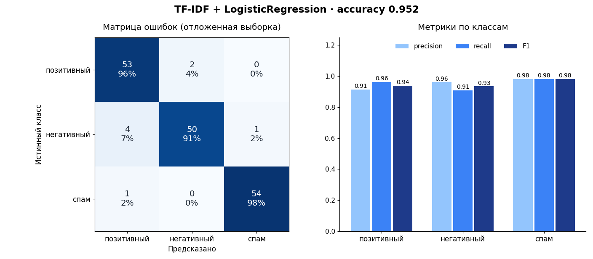

# Метрики модели

Датасет: 660 текстов, отложенная выборка: 165 (25%, стратифицированно).

## Кросс-валидация (5 фолдов)

| Модель | Accuracy | F1 macro |
|---|---|---|
| TF-IDF + LogisticRegression **(выбрана)** | 0.965 ± 0.014 | 0.965 ± 0.014 |
| TF-IDF + LinearSVC | 0.965 ± 0.014 | 0.965 ± 0.014 |

## Отложенная выборка: TF-IDF + LogisticRegression

Accuracy **0.952**, F1 macro **0.951**.

| Класс | Precision | Recall | F1 | Примеров |
|---|---|---|---|---|
| позитивный | 0.914 | 0.964 | 0.938 | 55 |
| негативный | 0.962 | 0.909 | 0.935 | 55 |
| спам | 0.982 | 0.982 | 0.982 | 55 |

### Матрица ошибок

| истинный \ предсказанный | позитивный | негативный | спам |
|---|---|---|---|
| позитивный | 53 | 2 | 0 |
| негативный | 4 | 50 | 1 |
| спам | 1 | 0 | 54 |

### Ошибки модели

- «Отличный способ потерять деньги и время.» — истинный: негативный, предсказан: позитивный
- «Обещали два дня, везли две недели.» — истинный: негативный, предсказан: спам
- «Купить отзывы на маркетплейс оптом» — истинный: спам, предсказан: позитивный
- «Ни одной претензии за год использования.» — истинный: позитивный, предсказан: негативный
- «Таксист курил в машине и ехал как попало.» — истинный: негативный, предсказан: позитивный
- «Ждали столик сорок минут, официант нахамил.» — истинный: негативный, предсказан: позитивный
- «Цена кусается, но ни разу не пожалела о покупке.» — истинный: позитивный, предсказан: негативный
- «Спасибо, конечно, что вообще доставили. Через три часа и холодное.» — истинный: негативный, предсказан: позитивный
